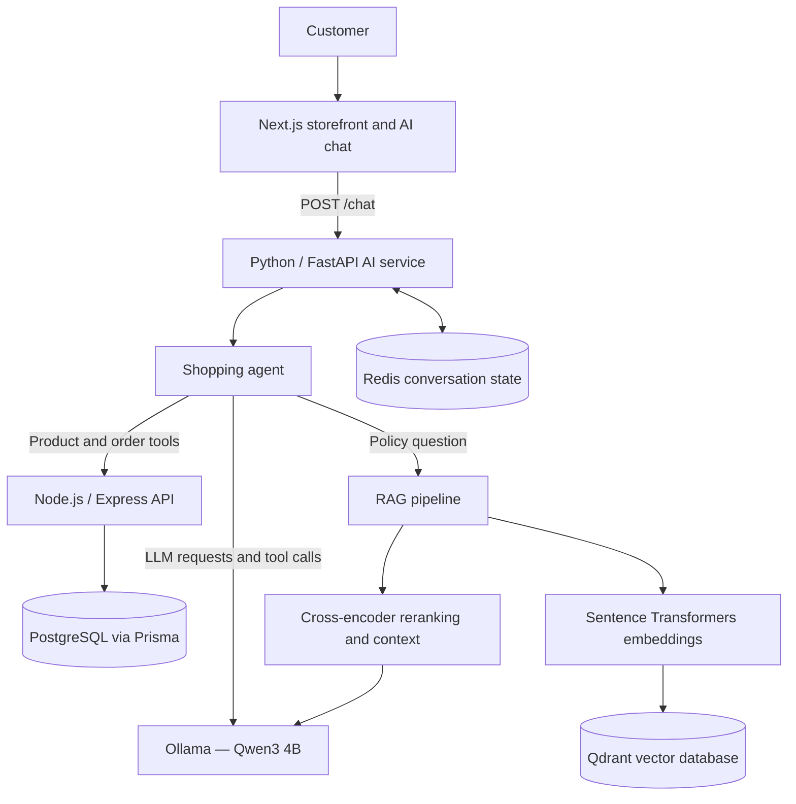

# KK Store — AI-Powered Shopping Assistant

An AI shopping assistant integrated into the KK Store e-commerce application. Customers can discover products, ask follow-up questions, retrieve authenticated order information, and get answers grounded in store-policy documentation through a natural-language chat interface.

The project combines a Next.js storefront, a Node.js/Express application backend, and a Python/FastAPI AI service. It demonstrates LLM tool calling, semantic product retrieval, retrieval-augmented generation (RAG), reranking, and Redis-backed conversation state.

> **Status:** The currently implemented assistant flows have been verified end to end in the local development environment. A public AI demo is not currently provided. Local setup still requires environment-specific credentials and populated Qdrant collections.

## Features

- **Conversational shopping:** Ask questions in natural language and continue with follow-ups such as “show me something cheaper” or “tell me more about that product.”
- **Product search:** Search the store catalog using filters such as product type, maximum price, and color.
- **Product details:** Retrieve product information from the application backend.
- **Semantic product search:** Retrieve candidate products using embeddings and Qdrant, then hydrate results from the application API so current catalog data remains authoritative.
- **Authenticated order lookup:** Retrieve the signed-in customer's orders through the existing backend authentication flow.
- **Policy Q&A with RAG:** Answer questions about shipping, returns, payments, warranty, and product care using retrieved store documentation.
- **Retrieval and reranking:** Retrieve relevant knowledge passages, rerank candidates, and prepare context for generation.
- **Multi-turn conversation state:** Store conversation messages in Redis with a one-hour TTL.

## Architecture



### Responsibility boundaries

- **Next.js frontend:** Renders the storefront and chat UI. The chat sends requests to the FastAPI service.
- **Node.js/Express backend:** Owns application APIs, business logic, authentication, and access to the store database.
- **Python/FastAPI AI service:** Orchestrates the agent, model requests, tools, retrieval, and conversation state.
- **Ollama:** Runs the configured local model, currently `qwen3:4b`, for agent and RAG generation.
- **Qdrant and Sentence Transformers:** Support semantic product retrieval and policy-document retrieval.
- **Redis:** Stores conversation messages for follow-up turns.

The AI service does not directly query PostgreSQL. Product and order information is obtained through the application API. Order access must continue to be authorized by the backend; model-generated tool arguments are not an authorization boundary.

## End-to-end verification

The following currently implemented flows have been verified end to end in the local development environment:

| Flow | What it verifies |
|---|---|
| Product discovery | A natural-language request is translated into a product-tool call and returns catalog results |
| Product details | The assistant can retrieve details for an identified product |
| Semantic product search | Vector search returns candidates and the backend supplies current product data |
| Authenticated order lookup | The assistant passes the signed-in user's authentication context to the backend order API |
| Store-policy questions | The RAG pipeline retrieves and reranks policy passages before generating an answer |
| Multi-turn conversation | Conversation history can be reused across turns through Redis |

These are functional end-to-end checks in the configured local environment; they are not a claim of load testing, independent security auditing, or production deployment.

## Tech stack

| Layer | Technologies |
|---|---|
| Frontend | Next.js, React, TypeScript |
| Application API | Node.js, Express.js |
| Database | PostgreSQL, Prisma |
| AI API | Python, FastAPI, Pydantic |
| Agent / LLM | Ollama, Qwen3 4B, tool calling |
| Embeddings | Sentence Transformers, `all-MiniLM-L6-v2` |
| Vector database | Qdrant |
| Reranking | Sentence Transformers CrossEncoder, `cross-encoder/ms-marco-MiniLM-L-6-v2` |
| Conversation state | Redis |

## Repository structure

```text
kkstore/
├── ai/
│   ├── app/
│   │   ├── agents/       # Shopping-agent orchestration
│   │   ├── ingestion/    # Ingestion-related code
│   │   ├── llm/          # Model client and tool schemas
│   │   ├── rag/          # Retrieval, reranking, context and generation
│   │   ├── schemas/      # Pydantic request/result schemas
│   │   ├── tools/        # Product, order and knowledge tools
│   │   └── main.py       # FastAPI entry point
│   ├── knowledge/        # Store-policy knowledge documents
│   └── requirements.txt
├── backend/              # Node.js / Express API and Prisma schema
└── frontend/             # Next.js storefront and AI chat interface
```

## Local development setup

The services below assume the default local ports used by the current code:

| Service | Local address |
|---|---|
| Next.js frontend | `http://localhost:3000` |
| Node.js backend | `http://localhost:5000` |
| FastAPI AI service | `http://localhost:8000` |
| Redis | `localhost:6379` |
| Qdrant | `http://localhost:6333` |
| Ollama | `localhost:11434` |

### Prerequisites

- Node.js and npm
- Python 3.11 or a compatible Python version supported by the dependencies
- PostgreSQL and the backend's required environment configuration
- Docker, for local Redis and Qdrant containers (or equivalent running services)
- Ollama

### 1. Clone the AI branch

```bash
git clone https://github.com/PreetsGeethub/kkstore.git
cd kkstore
git switch feat/kkstore-ai-assistant
```

### 2. Start Redis and Qdrant

If they are not already running locally, start the services with Docker:

```bash
docker run -d --name kkstore-redis -p 6379:6379 redis:7
docker run -d --name kkstore-qdrant -p 6333:6333 -p 6334:6334 -v kkstore-qdrant-data:/qdrant/storage qdrant/qdrant
```

If a container with either name already exists, start that container instead of creating a duplicate.

The current code expects the Qdrant collections `kkstore_products` and `kkstore_knowledge` to contain indexed data. Make sure the product vectors and policy chunks have been indexed before testing semantic search and policy RAG. A single documented, fresh-clone indexing command is still a setup improvement to make.

### 3. Start Ollama and pull the model

Install Ollama using its official installation instructions, start the Ollama service, and pull the model used by the current agent:

```bash
ollama pull qwen3:4b
```

The AI service currently calls Ollama directly. Other provider-specific code in the repository should not be assumed to be the active provider for the shopping-agent flow.

### 4. Configure and start the Node.js backend

```bash
cd backend
npm install
```

Copy `backend/.env.example` to `backend/.env`, then fill in the Supabase `DATABASE_URL` (runtime connection) and `DIRECT_URL` (direct connection for Prisma CLI/migrations), plus strong, unique JWT secrets. Set `CLIENT_URL` to the frontend origin. Configure Google OAuth, Razorpay, Cloudinary, and Gemini values only for features you enable. In production, the backend fails at startup if its required database, JWT, or frontend-origin configuration is missing. Never commit real credentials.

The backend defaults to port `5000`; set `PORT` explicitly when your environment requires a different port. Start the server:

```bash
npm run dev
```

Make sure PostgreSQL is reachable and the backend's Prisma client/database setup has been completed using the project's existing backend workflow before testing API calls.

### 5. Configure and start the AI service

Open a separate terminal from the repository root:

```bash
cd ai
python -m venv .venv
```

Activate the environment.

**Windows PowerShell**

```powershell
.\.venv\Scripts\Activate.ps1
```

**macOS / Linux**

```bash
source .venv/bin/activate
```

Install Python dependencies and configure the AI service:

```bash
pip install -r requirements.txt
cp .env.example .env
```

Adjust `.env` for your environment. The service reads `BACKEND_URL`, `OLLAMA_BASE_URL`, `OLLAMA_MODEL`, `REDIS_URL`, `QDRANT_URL`, optional `QDRANT_API_KEY`, embedding/reranker model names, request timeout, and `AI_ALLOWED_ORIGINS` from environment variables. Defaults are suitable only for local development; use private service URLs and exact trusted origins in production.

Start FastAPI after indexing the Qdrant collections in the next step:

```bash
uvicorn app.main:app --host 0.0.0.0 --port 8000
```

For local development, you can add `--reload`.

### 6. Index product and policy data in Qdrant

Start the Node backend, Ollama, Redis, and Qdrant first. Then, from the `ai` directory with the Python virtual environment active, run:

```bash
python -m app.index_products
python -m app.ingestion.knowledge_qdrant
```

The product indexer reads the current catalog through the Node API. The knowledge indexer reads Markdown policy files from `ai/knowledge`, creates the knowledge collection if needed, updates changed chunks, and removes stale chunks. Re-run indexing when the catalog or policy documents change.

### 7. Configure and start the frontend

Copy `frontend/.env.example` to `frontend/.env.local`. Set `NEXT_PUBLIC_API_URL` to the Node API base URL (including `/api/v1`) and `NEXT_PUBLIC_AI_URL` to the FastAPI base URL. The example file contains local-development defaults.

Then start the frontend in another terminal:

```bash
cd frontend
npm install
npm run dev
```

Open `http://localhost:3000`. The AI service exposes `GET /health/live`; the Node API exposes the same liveness path. Configure `AI_ALLOWED_ORIGINS` as a comma-separated list of exact frontend origins. For production order lookup, make sure the auth cookie can be sent to the AI origin: when all services use subdomains of the same site, configure `COOKIE_DOMAIN` (for example, `.kkstore.in`) and HTTPS consistently. Leave it blank for local development.

> **Local setup note:** This repository still relies on environment-specific backend configuration and pre-indexed Qdrant data. If you are setting it up from a fresh clone, complete those prerequisites before treating the local setup as reproducible.

## Security notes

- Keep API keys, database credentials, JWT secrets, and local `.env` files out of version control.
- Keep authentication and authorization decisions in the Node.js backend. The model must not be trusted to select or authorize a customer identity.
- Forward the authenticated user's cookie only to the intended backend endpoint, and verify order ownership in the backend.
- Treat user prompts, retrieved documents, tool arguments, and model output as untrusted input.
- Avoid logging cookies, tokens, full order payloads, or other personal data. Review development debug logging before any public deployment.
- Configure CORS and credentialed cookies explicitly for the intended origins before hosting the AI service publicly.

## Current limitations and next steps

- No public AI demo is currently documented; the verified assistant flows run in the configured local environment.
- Fresh-clone setup still requires backend-specific environment/database setup and pre-indexed Qdrant collections.
- The active shopping-agent path uses Ollama and the local Qwen3 4B model; deploying to a small server requires a hosted inference option or a separate inference host.
- Before production use, add automated regression tests for tool calling and RAG, evaluate answer quality against a representative question set, and review logging, error handling, latency, and security.
- Environment-backed service URLs, environment examples, health endpoints, and repeatable Qdrant collection setup/indexing scripts have been added. These changes still need fresh-clone verification and automated regression coverage before production use.

## Author

Built by [PreetsGeethub](https://github.com/PreetsGeethub) as an AI integration project for KK Store, combining e-commerce APIs, LLM tool calling, semantic search, RAG, reranking, and conversation state.
