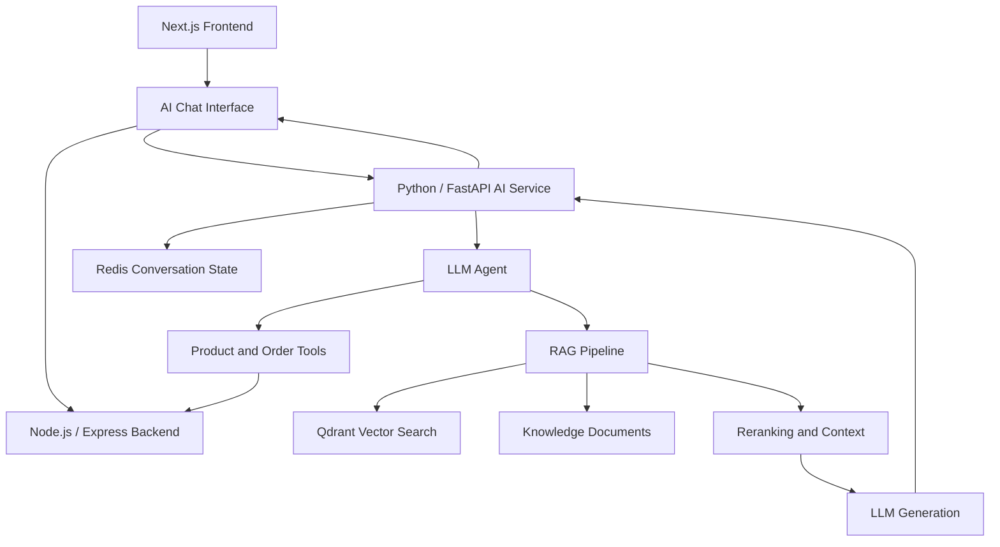

# KK Store — AI-Powered E-commerce Shopping Assistant

An AI shopping assistant built for KK Store that helps customers discover products, retrieve store policy information, and interact with e-commerce functionality through natural language.

The project combines an existing e-commerce application with a dedicated Python AI service, LLM tool calling, retrieval-augmented generation (RAG), and supporting infrastructure.

> **Project status:** AI integration in development. See the feature branch for the latest implementation.

## Key Features

- **Conversational shopping:** Interact with the store through a natural-language chat interface.
- **Product discovery:** Use AI tools to search products and retrieve product details from the store.
- **Order-related tools:** Support order-related operations through dedicated tools, subject to authentication and authorization requirements.
- **Knowledge retrieval:** Retrieve relevant information from store policies and product-care documentation.
- **RAG pipeline:** Separate retrieval, reranking, context preparation, and generation components.
- **Conversation handling:** Redis integration for conversation-related state.
- **Vector search:** Qdrant integration for storing and retrieving vector representations.

## Architecture



The Node.js backend remains responsible for application data and business operations. The Python AI service coordinates language-model interactions, retrieval, and tool execution rather than directly accessing the PostgreSQL database.

## Tech Stack

| Layer | Technologies |
|---|---|
| Frontend | Next.js, React, TypeScript |
| Application backend | Node.js, Express.js |
| Database and ORM | PostgreSQL, Prisma |
| AI service | Python, FastAPI |
| LLM integration | Ollama and configurable model integrations |
| Embeddings | Sentence Transformers, `all-MiniLM-L6-v2` |
| Vector database | Qdrant |
| Conversation state | Redis |
| Retrieval and ranking | Vector retrieval, reranking, context preparation |

## How It Works

### 1. User interaction

Customers interact with the assistant through a chat interface integrated into the storefront.

### 2. Tool-based shopping

The AI agent can use dedicated tools for operations such as:

- `search_products` — find products matching a query.
- `get_product_details` — retrieve details about a specific product.
- Order-related tools — support relevant order operations.

Product and order information is obtained through application tools, keeping the existing backend as the authority for store data.

### 3. Retrieval-Augmented Generation

For questions about store policies and related knowledge, the AI service uses a retrieval pipeline:

1. Represent knowledge documents using embeddings.
2. Retrieve relevant information from Qdrant.
3. Rerank retrieved passages where configured.
4. Prepare context for the language model.
5. Generate a response using the retrieved information.

Knowledge documents currently cover:

- Payment policy
- Product care
- Return policy
- Shipping policy
- Warranty policy

### 4. Conversation management

Redis is integrated for conversation-related state, supporting the assistant's multi-turn interaction flow.

## Repository Structure

```text
kkstore/
├── ai/
│   ├── app/
│   │   ├── agents/
│   │   ├── ingestion/
│   │   ├── llm/
│   │   ├── rag/
│   │   ├── schemas/
│   │   ├── tools/
│   │   └── main.py
│   ├── knowledge/
│   └── .gitignore
├── backend/
│   └── Node.js / Express application
└── frontend/
    ├── app/
    ├── components/
    └── lib/
```

## Getting Started

### Prerequisites

- Node.js and npm
- Python
- PostgreSQL
- Redis
- Qdrant
- An available LLM provider or local model runtime, depending on the selected configuration

### 1. Clone the repository

```bash
git clone <your-repository-url>
cd kkstore
git switch feat/kkstore-ai-assistant
```

### 2. Configure the application backend

```bash
cd backend
npm install
```

Configure the backend environment variables for the database connection and other required services using your existing local configuration.

Start the backend using the development command defined in `backend/package.json`.

### 3. Configure the AI service

```bash
cd ai
python -m venv .venv
```

Activate the virtual environment.

**Windows PowerShell:**

```powershell
.\.venv\Scripts\Activate.ps1
```

Install the AI service's dependencies using its dependency manifest, once the project setup instructions are finalized.

Create a local `.env` file containing the required configuration for the selected LLM provider, backend connection, Qdrant, and Redis. Use the variable names expected by the application code. Never commit real API keys or credentials.

### 4. Start the AI service

From the `ai` directory, run the FastAPI application using the module and server command configured for this project.

The exact command, required environment variables, and dependency installation steps should be documented after verifying the current application entry point and deployment configuration.

### 5. Start the frontend

```bash
cd frontend
npm install
npm run dev
```

Open the local URL printed by the development server.

> **Note:** The services must be configured to communicate with one another. Complete setup instructions and a verified end-to-end demo are still needed before this repository can be considered fully reproducible from a fresh clone.

## Security Considerations

- Keep API keys, database credentials, and local environment files out of version control.
- Validate requests at the API boundary.
- Enforce authentication and authorization for user-specific order operations.
- Keep product, inventory, pricing, and order data grounded in trusted application sources.
- Treat retrieved documents and model-generated output as untrusted input.

## Current Limitations

- The AI integration is still being developed and verified.
- Fresh-clone setup instructions need to be finalized.
- End-to-end behavior, including tool execution and multi-turn responses, requires continued testing.
- Deployment configuration and production readiness should be documented separately once verified.

## Future Improvements

- Improve retrieval quality and evaluate it against a larger, representative question set.
- Strengthen grounded response generation and reduce incorrect details introduced during final synthesis.
- Add robust authentication and authorization for order-related tools.
- Improve observability, error handling, latency, and automated testing.
- Deploy the AI service and document a working public demonstration.

## Author

**KK Store AI Shopping Assistant**

Built as an AI integration project combining e-commerce application development, LLM tool calling, retrieval, and supporting infrastructure.
