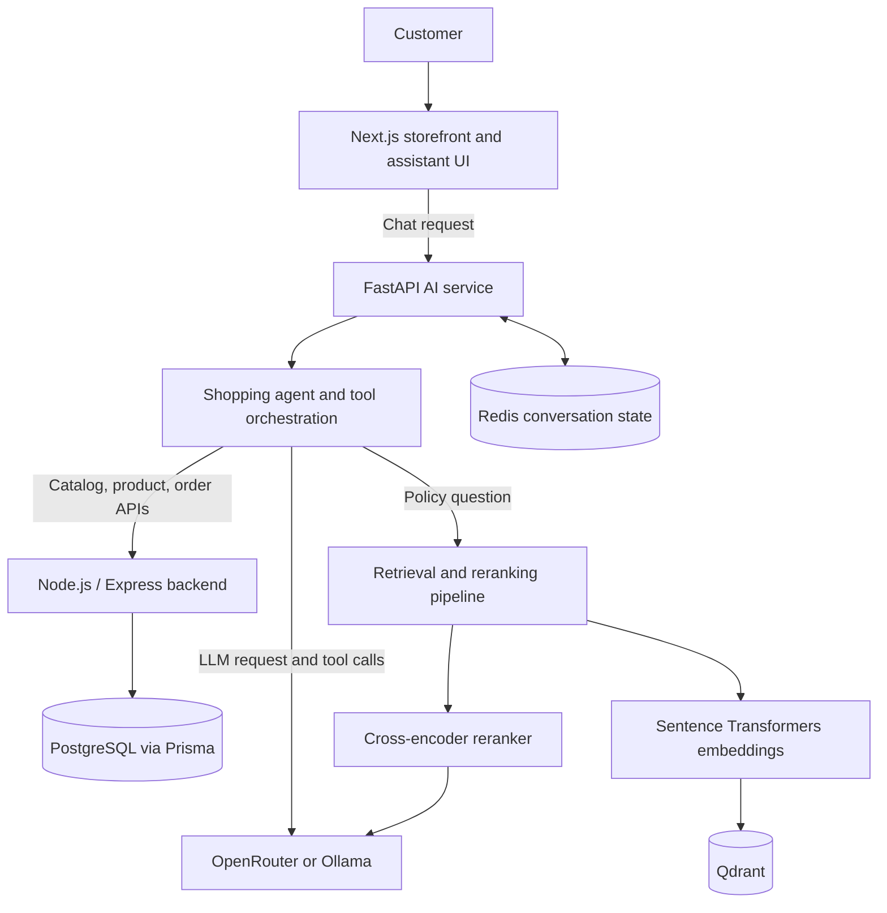

# KK Store — AI-Powered Conversational Shopping

**KK Store** is a full-stack e-commerce platform with an AI shopping assistant. The goal is to let customers discover products and get store-specific help through natural conversation, while the existing application backend remains responsible for catalog data, authentication, and authorization.

- **Live storefront:** https://www.kkstore.in/
- **Repository:** https://github.com/PreetsGeethub/kkstore
- **AI service host:** https://ai.kkstore.in
- **Frontend:** Next.js, React, TypeScript
- **Application API:** Node.js, Express, Prisma, PostgreSQL
- **AI service:** Python, FastAPI, LLM tool calling, RAG, Qdrant, Redis

> **Deployment note:** The storefront and AI service are deployed separately from the source repository. Merging code into `main` does not by itself prove that every new UI change has reached production. Check the live site after the hosting provider finishes its deployment.

## What it does

### Storefront
- E-commerce storefront with product browsing and product pages.
- Existing cart, checkout, and account flows are provided by the store application.
- Responsive Next.js interface.
- AI assistant launcher in the lower-left corner, positioned opposite the WhatsApp widget.
- First-visit KK robot introduction with an animated entrance, greeting, skip/close controls, and reduced-motion support.
- Hover/focus greeting and a subtle animated glow on the compact assistant launcher.

### AI shopping assistant

Implemented assistant capabilities include:

- **Natural-language product search:** Ask for products using criteria such as type, budget, or other supported catalog filters.
- **Product details:** Ask follow-up questions about a product and retrieve its details from the application backend.
- **Semantic product retrieval:** Use embeddings and Qdrant to find relevant catalog candidates, then retrieve current product data from the backend.
- **Authenticated order lookup:** Retrieve the signed-in customer's order information through the existing backend authentication and authorization flow.
- **Store-policy answers:** Retrieve relevant policy passages for questions about topics such as shipping, returns, payment policies, warranty, and product care.
- **RAG and reranking:** Retrieve knowledge chunks, rerank candidates with a cross-encoder, and provide relevant context for answer generation.
- **Multi-turn conversation:** Store conversation history in Redis with a one-hour TTL, scoped to a verified customer identity or a hashed guest-session identifier.
- **Configurable LLM provider:** Use OpenRouter for hosted inference or Ollama for local inference.
- **Remote MCP integration:** The project also includes an OAuth-protected remote MCP integration for exposing supported product tools to compatible clients such as Claude.

**Scope clarification:** The AI chat currently supports the tools wired into the agent (product search, product details, order lookup, and knowledge retrieval). Do not assume that cart edits, address changes, or checkout/payment actions can be completed through chat unless those specific agent tools and end-to-end flows have been implemented and verified. The storefront's existing commerce flows are separate from assistant capabilities.

## Architecture



### Service responsibilities

| Component | Responsibility |
|---|---|
| `frontend/` | Next.js storefront, shopping UI, AI launcher, chat panel, and frontend API clients |
| `backend/` | Node.js/Express APIs, business logic, authentication, authorization, and catalog/order data access |
| `ai/` | FastAPI endpoints, agent orchestration, model provider, product/order/knowledge tools, RAG, and conversation state |
| PostgreSQL / Prisma | Persistent store application data |
| Qdrant | Vector retrieval for product and knowledge collections |
| Redis | Multi-turn conversation state with expiry |
| OpenRouter / Ollama | Configurable LLM inference provider |

The AI service should access store data through backend APIs rather than querying PostgreSQL directly. Authorization decisions—especially order ownership—must be enforced by the backend, not by the model or prompt.

## Retrieval and evaluation

The RAG pipeline combines semantic retrieval and cross-encoder reranking for store-policy knowledge. The project's recorded 20-query evaluation achieved:

| Metric | Result |
|---|---:|
| Recall@3 | 100% |
| Recall@1 | 94% |
| MRR@3 | 0.97 |

These figures describe the recorded test set, not a guarantee of production answer quality. Keep evaluation questions and results aligned when changing chunking, embeddings, retrieval, or reranking.

## Technology stack

| Area | Technologies |
|---|---|
| Frontend | Next.js, React, TypeScript, Tailwind CSS |
| Backend | Node.js, Express.js |
| Database and ORM | PostgreSQL, Prisma |
| AI API | Python, FastAPI, Pydantic |
| LLM providers | OpenRouter, Ollama |
| Agent | Tool/function calling, multi-tool orchestration |
| RAG | Sentence Transformers, dense retrieval, cross-encoder reranking |
| Vector database | Qdrant |
| Conversation state | Redis |
| MCP and access | Model Context Protocol, OAuth 2.0, WorkOS AuthKit (for the remote MCP integration) |
| Deployment and testing | Docker, VPS, Nginx, GitHub Actions, GHCR, pytest, k6 |

## Repository structure

```text
kkstore/
├── ai/
│   ├── app/
│   │   ├── agents/       # Shopping-agent orchestration
│   │   ├── ingestion/    # Policy knowledge ingestion
│   │   ├── llm/          # Model clients and tool schemas
│   │   ├── rag/          # Retrieval, reranking, and generation
│   │   ├── schemas/      # Pydantic request/result schemas
│   │   ├── tools/        # Product, order, and knowledge tools
│   │   └── main.py       # FastAPI entry point
│   ├── knowledge/        # Store policy documents
│   ├── compose.yaml      # Optional resource-limited AI container
│   └── requirements.txt
├── backend/              # Node.js / Express API and Prisma schema
├── frontend/             # Next.js storefront and AI assistant UI
└── README.md
```

## Local development

### Prerequisites

- Node.js and npm
- Python 3.11 or a version supported by `ai/requirements.txt`
- PostgreSQL with the backend environment configured
- Redis and Qdrant (Docker is one option)
- An API key and model identifier for OpenRouter, or an installed Ollama model

### 1. Clone the repository

```bash
git clone https://github.com/PreetsGeethub/kkstore.git
cd kkstore
```

Use `main` for the latest integrated code. Feature branches may contain work that has not been merged.

### 2. Start Redis and Qdrant

If you do not already have local instances:

```bash
docker run -d --name kkstore-redis -p 6379:6379 redis:7
docker run -d --name kkstore-qdrant -p 6333:6333 -p 6334:6334 -v kkstore-qdrant-data:/qdrant/storage qdrant/qdrant
```

If a container with either name already exists, start that container rather than creating a duplicate. The AI service expects the `kkstore_products` and `kkstore_knowledge` Qdrant collections to be populated before semantic retrieval and policy RAG can work.

### 3. Configure and start the backend

```bash
cd backend
npm install
```

Copy `backend/.env.example` to `backend/.env` and fill in the required database connection URLs, unique JWT secrets, and frontend origin. Configure optional third-party integrations only if using them. Then start the backend:

```bash
npm run dev
```

The default local API port is `5000`. Complete the repository's existing Prisma/database setup before testing database-backed routes.

### 4. Configure and start the AI service

From the repository root:

```bash
cd ai
python -m venv .venv
```

Activate the environment:

**Windows PowerShell**
```powershell
.\.venv\Scripts\Activate.ps1
```

**macOS / Linux**
```bash
source .venv/bin/activate
```

Install dependencies and create the local environment file:

```bash
pip install -r requirements.txt
cp .env.example .env
```

Configure the selected provider and service URLs. For OpenRouter, set `LLM_PROVIDER=openrouter`, `OPENROUTER_API_KEY`, and `OPENROUTER_MODEL`. For Ollama, set `LLM_PROVIDER=ollama`, `OLLAMA_BASE_URL`, and `OLLAMA_MODEL`.

Start the AI API:

```bash
uvicorn app.main:app --reload --host 127.0.0.1 --port 8000
```

### 5. Index products and knowledge

With the backend, Qdrant, Redis, and selected LLM provider available, run these commands from the `ai/` directory:

```bash
python -m app.index_products
python -m app.ingestion.knowledge_qdrant
```

Re-run the relevant indexer when catalog or policy content changes.

### 6. Configure and start the frontend

In another terminal:

```bash
cd frontend
npm install
```

Copy `frontend/.env.example` to `frontend/.env.local`. Set `NEXT_PUBLIC_API_URL` to the Node API base URL (including `/api/v1` if required by the configured client), and `NEXT_PUBLIC_AI_URL` to the FastAPI AI service URL.

Start the Next.js app:

```bash
npm run dev
```

Open http://localhost:3000.

### Local service URLs

| Service | Default local address |
|---|---|
| Next.js | `http://localhost:3000` |
| Node.js / Express | `http://localhost:5000` |
| FastAPI AI service | `http://localhost:8000` |
| Redis | `localhost:6379` |
| Qdrant | `http://localhost:6333` |
| Ollama (optional) | `http://localhost:11434` |

Exact values should be set in the relevant environment files; production endpoints and credentials must not be hard-coded.

## Optional AI container

The AI service includes `ai/compose.yaml` for a resource-limited container. It manages the AI service only; it does not deploy or take ownership of the other services.

Review `ai/.env.example` and configure `ai/.env` first, then inspect the rendered configuration before starting it:

```bash
docker compose -f ai/compose.yaml config
docker compose -f ai/compose.yaml up -d --build
docker compose -f ai/compose.yaml ps
docker compose -f ai/compose.yaml logs --tail=100 ai
```

The Compose configuration binds the AI port to localhost and sets resource limits. Verify that URLs, secrets, and dependencies are appropriate for the host before running it.

## Security considerations

- Never commit real API keys, database credentials, JWT secrets, or populated local environment files.
- Enforce order ownership and customer authorization in the backend.
- Treat prompts, retrieved documents, model output, and tool arguments as untrusted input.
- Avoid logging cookies, access tokens, and unnecessary personal/order data.
- Configure CORS, HTTPS, and credentialed cookies for exact trusted origins.
- Do not expose internal service ports publicly unless protected by the intended network and reverse-proxy configuration.

## Current scope and roadmap

The assistant currently focuses on product discovery, product details, authenticated order lookup, and store-policy questions. The customer-facing interface is designed to make these capabilities easier to access.

Potential future extensions include:
- Conversational cart updates and multi-item cart management.
- Address selection or management during a shopping flow.
- Guided checkout and payment initiation with explicit user confirmation.
- Automated regression/evaluation coverage for tool calling, RAG, and conversation state.
- Production observability for latency, failures, and answer quality.

These are roadmap items unless the corresponding tools and complete flows are implemented and tested. The existing storefront checkout and payment integrations do not automatically mean that the AI assistant can operate them.

## Author

Built by [PreetsGeethub](https://github.com/PreetsGeethub) as an AI integration project for KK Store.
